<picture>
  <source media="(prefers-color-scheme: dark)" srcset="./assets/sheet-en-dark.svg">
  
</picture>

🇺🇸 English · <a href="./README.pt-BR.md">🇧🇷 Português</a>

Hi, I'm Iago 👋

Above is my character sheet. Below are some missions I've completed. Some run in production for clients. Others I built just for fun.

## 📜 Missions

<table>
  <tr>
    <td width="50%" valign="top">
      <h3>🍔 Self-service kiosk</h3>
      
Ordering kiosk for busy restaurants. Ordering and payment flows, running on real hardware. I led the build, app and API.

      
<code>React Native</code> <code>NestJS</code> <code>TypeScript</code>

      🔒 Client project · in production
    </td>
    <td width="50%" valign="top">
      <h3>🪐 <a href="https://github.com/Iago-leles/solar-system">3D Solar System</a></h3>
      
The whole solar system in your browser. Orbits, moons, rings, comets and a black hole. Plus a Millennium Falcon being chased by fighters.

      
<code>Next.js</code> <code>TypeScript</code> <code>Three.js</code>

      <a href="https://solar-system.iagoleles.com"><strong>▶ Play</strong></a>
    </td>
  </tr>
  <tr>
    <td width="50%" valign="top">
      <h3>📊 Restaurant management system</h3>
      
Management platform used by 50+ restaurants. I worked on performance and built a new messaging feature.

      
<code>React</code> <code>TypeScript</code>

      🔒 Client project · in production
    </td>
    <td width="50%" valign="top">
      <h3>🎧 <a href="https://github.com/Iago-leles/spotify-ai">Spotify AI</a></h3>
      
Tell it what you want to hear. Gemini picks the songs. The playlist lands in your Spotify in under 10 seconds.

      
<code>Next.js 16</code> <code>TypeScript</code> <code>Gemini</code> <code>Spotify OAuth</code>

      <a href="https://spotify-ai.iagoleles.com"><strong>▶ Play</strong></a>
    </td>
  </tr>
  <tr>
    <td width="50%" valign="top">
      <h3>🩺 Healthcare app</h3>
      
Mobile app used by medical professionals. I build new features and handle releases to the App Store and Play Store.

      
<code>React Native</code> <code>TypeScript</code>

      🔒 Client project · in production
    </td>
    <td width="50%" valign="top">
      <h3>🛋️ <a href="https://github.com/Iago-leles/maxlife">MaxLife</a></h3>
      
Catalog site for a real custom upholstery business. Editorial look, mobile-first, accessible.

      
<code>Vue 3</code> <code>Quasar</code> <code>TypeScript</code> <code>Pinia</code>

      <a href="https://maxlife.iagoleles.com"><strong>▶ Play</strong></a>
    </td>
  </tr>
</table>

## 🎒 Inventory

| Slot | Items |
|---|---|
| ⚔️ Main weapons |  |
| 🛡️ Backend armor |  |
| 🧪 Potions of testing |  |
| ✨ Spells |  &nbsp; React Native · AI agents (IDE + CLI) |
| 🧰 Tools |  |

## 🤝 Looking for party members

Got a quest, a weird idea or an interesting role? Press start.

💾 Game saved. Thanks for stopping by.

