<picture>
  <source media="(prefers-color-scheme: dark)" srcset="./assets/sheet-pt-dark.svg">
  
</picture>

<a href="./README.md">🇺🇸 English</a> · 🇧🇷 Português

Oi, eu sou o Iago 👋

Aí em cima está a minha ficha de personagem. Aqui embaixo estão algumas missões que concluí. Algumas rodam em produção para clientes. Outras eu fiz só por diversão.

## 📜 Missões

<table>
  <tr>
    <td width="50%" valign="top">
      <h3>🍔 Totem de autoatendimento</h3>
      
Totem de pedidos para restaurantes movimentados. Fluxos de pedido e pagamento, rodando em hardware de verdade. Liderei o desenvolvimento, do app à API.

      
<code>React Native</code> <code>NestJS</code> <code>TypeScript</code>

      🔒 Projeto de cliente · em produção
    </td>
    <td width="50%" valign="top">
      <h3>🪐 <a href="https://github.com/Iago-leles/solar-system">Sistema Solar 3D</a></h3>
      
O sistema solar inteiro no navegador. Órbitas, luas, anéis, cometas e um buraco negro. E uma Millennium Falcon sendo perseguida por caças.

      
<code>Next.js</code> <code>TypeScript</code> <code>Three.js</code>

      <a href="https://solar-system.iagoleles.com"><strong>▶ Jogar</strong></a>
    </td>
  </tr>
  <tr>
    <td width="50%" valign="top">
      <h3>📊 Sistema de gestão de restaurantes</h3>
      
Plataforma de gestão usada por mais de 50 restaurantes. Trabalhei na performance e criei uma nova funcionalidade de mensageria.

      
<code>React</code> <code>TypeScript</code>

      🔒 Projeto de cliente · em produção
    </td>
    <td width="50%" valign="top">
      <h3>🎧 <a href="https://github.com/Iago-leles/spotify-ai">Spotify AI</a></h3>
      
Diga o que quer ouvir. O Gemini escolhe as músicas. A playlist cai no seu Spotify em menos de 10 segundos.

      
<code>Next.js 16</code> <code>TypeScript</code> <code>Gemini</code> <code>Spotify OAuth</code>

      <a href="https://spotify-ai.iagoleles.com"><strong>▶ Jogar</strong></a>
    </td>
  </tr>
  <tr>
    <td width="50%" valign="top">
      <h3>🩺 App da área médica</h3>
      
App mobile usado por profissionais de saúde. Desenvolvo novas funcionalidades e cuido dos releases na App Store e na Play Store.

      
<code>React Native</code> <code>TypeScript</code>

      🔒 Projeto de cliente · em produção
    </td>
    <td width="50%" valign="top">
      <h3>🛋️ <a href="https://github.com/Iago-leles/maxlife">MaxLife</a></h3>
      
Site de catálogo para uma empresa real de estofados sob medida. Visual editorial, mobile-first e acessível.

      
<code>Vue 3</code> <code>Quasar</code> <code>TypeScript</code> <code>Pinia</code>

      <a href="https://maxlife.iagoleles.com"><strong>▶ Jogar</strong></a>
    </td>
  </tr>
</table>

## 🎒 Inventário

| Slot | Itens |
|---|---|
| ⚔️ Armas principais |  |
| 🛡️ Armadura de backend |  |
| 🧪 Poções de teste |  |
| ✨ Magias |  &nbsp; React Native · agentes de IA (IDE + CLI) |
| 🧰 Ferramentas |  |

## 🤝 Procurando grupo

Tem uma missão, uma ideia maluca ou uma vaga interessante? Aperta start.

💾 Jogo salvo. Valeu pela visita.

